# PostgreSQL 스키마와 관계도

API 요청·응답 형식은 `docs/reference/`(API 명세서)를 봅니다. 이 문서는 DB 구조를 다룹니다.

## 사용 대상
| 사용자 | 언제 | 무엇을 |
| --- | --- | --- |
| `layer-architect` 에이전트 | 모듈 설계 | 테이블 설계의 기준으로 삼고, 바꿀 점은 "스키마 변경 제안"으로 분리 |
| `layer-implementer` 에이전트 | `models.py`, `repositories.py`, 도메인 클래스, 시드 데이터 작성 | 테이블명·컬럼·타입·FK와 UUID·TIMESTAMPTZ 매핑을 그대로 따름 |
| `layer-checker` 에이전트 | 계층 규칙 점검 | `models.py`가 `schema.sql`과 일치하는지 비교 |
| 메인 세션 | ERD 확인, 조인 쿼리 작성, 스키마 질문 | 관계도와 관계 목록 참고 |

팀 역할로는 **인프라 계층 담당**(models, repositories, lifespan 시드)이 주 사용자이고, 도메인·응용 계층 담당은 엔티티 속성과 모듈 간 관계를 확인할 때 씁니다.

스키마를 바꿀 때는 이 문서와 `schema.sql`을 함께 고칩니다. 두 파일이 어긋나면 에이전트가 잘못된 기준으로 코드를 작성하거나 점검하게 됩니다.

- 원본: 팀 ERD에서 내보낸 DDL (MySQL식 백틱 문법)
- 권장 DDL: 같은 폴더의 [`schema.sql`](schema.sql). 프로젝트 스택인 PostgreSQL 17(`compose.yaml`의 `postgres:17`)에서 전체 실행을 확인했습니다.
- 모든 PK는 `UUID`입니다. 실제 매핑 예시는 `src/auth/infrastructure/models.py`와 6절을 봅니다.

## 1. 관계도

```mermaid
erDiagram
    users ||--o{ point_log : "포인트 내역"
    users ||--o| password_reset_codes : "재설정 코드"
    users |o--o{ point_log : "지급한 관리자(created_by)"
    users ||--o| stores : "운영(owner_id)"
    users ||--o{ pickup_reservations : "예약"
    users |o--o{ stock_log : "재고 변경 주체"
    stores ||--o{ products : "판매 상품"
    products ||--o{ discount_offers : "마감 할인"
    discount_offers ||--o{ stock_log : "재고 변경 기록"
    discount_offers ||--o{ pickup_reservations : "예약 대상"
    pickup_reservations ||--o{ payments : "결제 시도"
    payments ||--o{ refunds : "환불"

    users {
        uuid id PK
        varchar email UK
        varchar password_hash
        varchar role
        varchar name
        varchar phone
        int users_point
        timestamptz created_at
        text business_number
        varchar status
        timestamptz approved_at
        varchar rejected_reason
        timestamptz rejected_at
        varchar suspended_reason
        timestamptz suspended_at
        timestamptz suspended_until
        timestamptz deleted_at
        varchar deleted_reason
        int token_version
        text token_keep_jti
        int failed_login_count
        timestamptz login_locked_until
    }
    point_log {
        uuid id PK
        uuid user_id FK
        int amount
        text point_type
        timestamptz created_at
        varchar reason
        int balance_after
        uuid created_by FK
    }
    token_blacklist {
        text jti PK
        timestamptz expires_at
    }
    password_reset_codes {
        uuid user_id PK, FK
        varchar code_hash
        timestamptz expires_at
        int failed_attempts
        timestamptz created_at
    }
    stores {
        uuid id PK
        uuid owner_id FK
        varchar name
        varchar pickup_address
        float8 latitude
        float8 longitude
        timestamptz created_at
        timestamptz approval_at
        timestamptz closed_at
        varchar suspended_reason
        timestamptz suspended_at
        varchar closed_reason
    }
    products {
        uuid id PK
        uuid store_id FK
        varchar name
        varchar category
        text description
        int original_price
        bool is_active
        json product_image
    }
    discount_offers {
        uuid id PK
        uuid product_id FK
        int sale_price
        int initial_stock
        int remaining_stock
        timestamptz sales_start
        timestamptz sales_end
        timestamptz pickup_start
        timestamptz pickup_end
        varchar status
        bool is_active
        int price
        varchar suspended_reason
        timestamptz suspended_at
    }
    stock_log {
        uuid id PK
        uuid offer_id FK
        uuid user_id FK
        int amount
        varchar reason
        timestamptz created_at
    }
    pickup_reservations {
        uuid id PK
        uuid user_id FK
        uuid offer_id FK
        int quantity
        int unit_price
        int total_price
        int price
        varchar status
        varchar pickup_code
        varchar store_name
        varchar pickup_address
        varchar product_name
        timestamptz created_at
        timestamptz cancelled_at
        timestamptz picked_up_at
    }
    payments {
        uuid id PK
        uuid reservation_id FK
        int amount
        int point_used
        varchar status
        varchar provider_payment_id
        timestamptz created_at
        timestamptz paid_at
        timestamptz failed_at
        jsonb failed_response
    }
    refunds {
        uuid id PK
        uuid payment_id FK
        int refund_amount
        int penalty_amount
        varchar reason
        varchar status
        timestamptz created_at
        timestamptz completed_at
        jsonb refund_reason
    }
```



핵심 흐름: **users(운영자) → stores → products → discount_offers → pickup_reservations → payments → refunds**

## 2. 관계 목록
원본 DDL에는 FK 제약이 없어서, 컬럼 이름으로 관계를 추론해 `schema.sql`에 FK를 넣었습니다.

| 자식 테이블.컬럼 | 부모 테이블 | 관계 | NULL | 비고 |
| --- | --- | --- | --- | --- |
| `point_log.user_id` | `users` | 1 : N | 불가 | 포인트 적립·사용 내역 |
| `point_log.created_by` | `users` | 0..1 : N | 가능 | 관리자 지급(`GRANT`)의 처리 관리자. 시스템 이벤트는 NULL (`docs/design/admin.md` S9) |
| `stores.owner_id` | `users` | 1 : 0..1 | 불가 | 상점주 1인 1상점 (API 명세). `UNIQUE`, 제약 이름 `uq_stores_owner_id` (레포지토리가 이 이름으로 중복 개설을 판별). 별도로 `UNIQUE (name, pickup_address)` `uq_stores_name_address`: 동일한 상점명·주소의 상점 금지, 폐점·정지 상점 포함 (`docs/design/stores.md` D33) |
| `products.store_id` | `stores` | 1 : N | 불가 | |
| `discount_offers.product_id` | `products` | 1 : N | 불가 | 같은 상품을 날마다 다시 할인 등록 |
| `stock_log.offer_id` | `discount_offers` | 1 : N | 불가 | 재고 차감·복구 기록 |
| `stock_log.user_id` | `users` | 0..1 : N | 가능 | 시스템이 조정하면 NULL |
| `pickup_reservations.user_id` | `users` | 1 : N | 불가 | |
| `pickup_reservations.offer_id` | `discount_offers` | 1 : N | 불가 | |
| `payments.reservation_id` | `pickup_reservations` | 1 : N | 불가 | `failed_at`이 있어 재시도를 고려해 1:N. 성공 결제는 예약당 1건 (확인 필요) |
| `refunds.payment_id` | `payments` | 1 : N | 불가 | 부분 환불을 허용하지 않으면 1:1로 `UNIQUE` 추가 (확인 필요) |

`password_reset_codes.user_id`는 `users`와 1 : 0..1(PK이자 FK)입니다. 회원당 재설정 코드 1개를 덮어쓰고, 성공하면 지웁니다. `users.token_version`·`token_keep_jti`는 비밀번호 변경·재설정 때 기존 토큰을 무효화하는 토큰 세대입니다. `users.failed_login_count`·`login_locked_until`은 로그인 연속 실패 잠금 상태입니다(5번째 실패에서 잠금 시각을 정하고 횟수는 0).

`token_blacklist`는 다른 테이블과 관계가 없습니다. 토큰의 `jti`와 만료 시각만 저장하고, 만료가 지난 행은 지워도 됩니다.

## 3. 모듈 배치
| 모듈 | 테이블 | 도메인 파일 |
| --- | --- | --- |
| `auth` | `users`, `point_log`, `token_blacklist`, `password_reset_codes` | `user.py`, `point_log.py`, `token_blacklist.py` |
| `stores` | `stores` | `store.py` |
| `catalog` | `products`, `discount_offers`, `stock_log` | `product.py`, `discount_offer.py`, `stock_log.py` |
| `reservations` | `pickup_reservations` | `pickup_reservation.py` (`reservation.py`는 대응 테이블 없음, 확인 필요) |
| `payments` | `payments`, `refunds` | `payment.py`, `refund.py` |

다른 모듈의 테이블을 FK로 참조할 때 `models.py`에서는 문자열(`ForeignKey("users.id")`)로만 연결하고, 다른 모듈의 모델 클래스를 import하지 않습니다. 모든 `models.py`가 `main.py`의 lifespan보다 먼저 import돼야 `create_all`이 FK 대상 테이블을 찾을 수 있습니다.

## 4. 원본 DDL에서 고친 부분
| 원본 | 문제 | `schema.sql` |
| --- | --- | --- |
| 백틱(`` `payments` ``) | MySQL 문법이라 PostgreSQL에서 오류 | 백틱 제거 |
| `` `role/admin` `` | `/`가 들어간 컬럼명은 따옴표 없이 쓸 수 없음 | `role` |
| `DOUBLE` | PostgreSQL에 없는 타입 | `DOUBLE PRECISION` |
| `TIMESTAMPZ` (`stock_log`, `point_log`) | 오타 | `TIMESTAMPTZ` |
| `products.store_id ... DEFAULT AS` | 문법 오류 | `DEFAULT` 제거 |
| `stores.approval_at VARCHAR(20)` | API 명세는 "개설 시각"(datetime)으로 사용 | `approval_at TIMESTAMPTZ` |
| 상태·유형 값 제약 없음 | 아무 문자열이나 저장됨 | API 명세로 확정된 값에 이름 있는 `CHECK`: `discount_offers.status`(`ck_offer_status`, `SUSPENDED` 포함), `point_log.point_type`(`ck_point_log_type`, `GRANT`·`EXPIRE` 포함), `users.status`(`ck_users_status`) |
| FK 없음 | 참조 무결성 보장 안 됨 | FK 11개와 인덱스 추가 |
| PK·`created_at` 기본값 없음 | 앱에서 매번 넣어야 함 | `gen_random_uuid()`, `now()` |
| 재고·금액 검증 없음 | 음수, 초과 재고 가능 | `remaining_stock BETWEEN 0 AND initial_stock`, 금액 `>= 0`, `quantity >= 1`, `pickup_end > pickup_start` |
| `users.email` 중복 허용 | 같은 이메일로 여러 계정 | `UNIQUE` |

## 5. 팀 확인이 필요한 항목
1. **중복 가격 컬럼:** `discount_offers.price`와 `sale_price`, `pickup_reservations.price`와 `unit_price`/`total_price`의 차이. 같은 의미라면 `price`를 빼는 것을 권장합니다.
2. **`refunds.reason`과 `refund_reason`(JSONB)의 구분.**
3. **남은 상태 값:** API 명세(`docs/reference/README.md`의 상태 값 표)로 `discount_offers.status`와 `point_log.point_type`은 확정됐습니다. `users.role`의 상점주 값, `pickup_reservations.status`(`RESERVED`의 의미), `payments.status`의 실패 값, `refunds.status`의 나머지 값이 남았습니다. 정해지면 도메인 클래스에 상수와 전이 규칙을 두고, DB에 `CHECK (status IN (...))`를 더합니다.
4. **(해결됨)** `products.name`·`original_price`, `discount_offers.sales_start`는 NOT NULL로 확정했고 `stock_log.reason`을 추가했습니다(`docs/design/catalog.md` S1·S2·S4).
5. **`pickup_code` 고유 범위:** 전체에서 고유인지, 매장·날짜 안에서만 고유인지.
6. **매장 재개점:** API 명세상 폐점은 `closed_at` 기록(소프트 삭제)이고 재개점이 가능하지만, 재개점 API와 이력 보관 방식이 정해지지 않았습니다. FK는 기본값(참조 중이면 삭제 불가)입니다.
7. **(해결됨)** 상점주 승인 상태: `users.status`(`PENDING`/`APPROVED`/`REJECTED`/`SUSPENDED`/`WITHDRAWN`)와 승인·거부·정지·탈퇴 시각·사유 컬럼을 추가했습니다. 관리자 정지용으로 `stores`·`discount_offers`에 `suspended_*`, `stores.closed_reason`, `point_log`에 `reason`·`balance_after`·`created_by`도 추가했습니다(`docs/design/admin.md` §2 S1~S11, D3). `create_all`은 이미 있는 테이블에 컬럼을 더하지 않으므로, 기존 개발 DB는 다시 만들거나 같은 문서 §2.4의 `ALTER`를 실행합니다.

## 6. SQLAlchemy 매핑 규칙
```python
import uuid
from datetime import datetime

from sqlalchemy import CheckConstraint, DateTime, ForeignKey, String
from sqlalchemy.dialects.postgresql import UUID
from sqlalchemy.orm import Mapped, mapped_column

from database import Base

TZ = DateTime(timezone=True)  # TIMESTAMPTZ


class DiscountOfferModel(Base):
    __tablename__ = "discount_offers"
    __table_args__ = (
        CheckConstraint("remaining_stock BETWEEN 0 AND initial_stock", name="ck_offer_remaining_stock"),
        CheckConstraint("pickup_end > pickup_start", name="ck_offer_pickup_window"),
    )

    id: Mapped[uuid.UUID] = mapped_column(UUID(as_uuid=True), primary_key=True, default=uuid.uuid4)
    product_id: Mapped[uuid.UUID] = mapped_column(UUID(as_uuid=True), ForeignKey("products.id"), index=True)
    sale_price: Mapped[int]
    initial_stock: Mapped[int]
    remaining_stock: Mapped[int]
    sales_start: Mapped[datetime] = mapped_column(TZ)
    sales_end: Mapped[datetime] = mapped_column(TZ)
    pickup_start: Mapped[datetime] = mapped_column(TZ)
    pickup_end: Mapped[datetime] = mapped_column(TZ)
    status: Mapped[str] = mapped_column(String(20))
    is_active: Mapped[bool] = mapped_column(default=True)
```

| PostgreSQL | SQLAlchemy | 파이썬 |
| --- | --- | --- |
| `UUID` | `UUID(as_uuid=True)` | `uuid.UUID` |
| `TIMESTAMPTZ` | `DateTime(timezone=True)` | `datetime` (항상 timezone 포함) |
| `JSONB` / `JSON` | `postgresql.JSONB` / `JSON` | `dict` / `list` |
| `DOUBLE PRECISION` | `Double` | `float` |
| `VARCHAR(n)` | `String(n)` | `str` |
| NULL 허용 컬럼 | `Mapped[X \| None]` | |

- `Mapped[datetime]`만 쓰면 timezone 없는 `TIMESTAMP`가 됩니다(직접 확인함). 위 예시처럼 컬럼마다 `DateTime(timezone=True)`를 지정하거나, `database.py`의 `Base`에 `type_annotation_map = {datetime: DateTime(timezone=True)}`를 둡니다.
- 도메인 클래스의 ID 타입도 `uuid.UUID`로 맞춥니다. 도메인은 `uuid`, `datetime` 같은 표준 라이브러리만 씁니다.
- 시간은 `datetime.now(timezone.utc)`로 만들고, 판매·픽업 시간 비교는 도메인 메서드 안에서 합니다.

## 7. 동시성이 중요한 쿼리
예약 생성 시 재고 차감은 같은 트랜잭션 안에서 처리합니다.

1. `discount_offers` 행을 `SELECT ... FOR UPDATE`로 잠급니다 (`with_for_update()`).
2. 도메인 메서드로 재고를 차감합니다. 판매 기간과 활성 여부도 검사합니다.
3. `pickup_reservations`, `stock_log`(`amount`는 음수)를 추가합니다.
4. `commit()`을 한 번 합니다.

예약 취소나 환불로 재고를 되돌릴 때도 같은 순서로 하고, `stock_log`에 양수로 기록합니다. DB의 `ck_offer_remaining_stock`은 앱 로직이 놓쳤을 때를 막는 마지막 방어선입니다.
