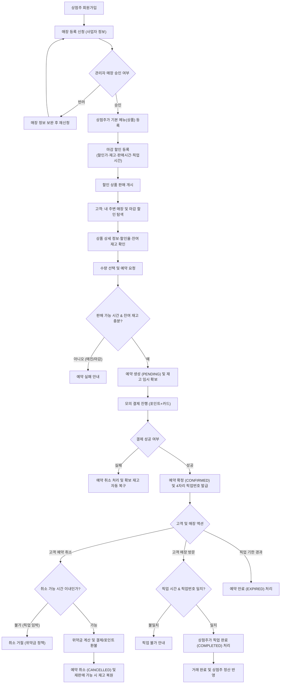

# 🍞 Last Call (라스트콜) — 마감 직전

> **"버려지는 음식은 줄이고, 가치 있는 소비를 연결합니다."**  
> 마감 시간이 가까워진 매장의 할인 음식을 고객이 예약·결제하고 직접 픽업하는 친환경 라스트오더 커머스 플랫폼

---

## 1. 서비스 목표

현대 외식업 매장에서는 매일 당일 제조된 신선한 음식들이 마감 시간 직전 판매되지 못하고 대량으로 폐기되고 있습니다. 이는 매장에는 식자재 원가 손실을, 환경에는 막대한 양의 음식물 쓰레기와 탄소 배출을 초래합니다.

**Last Call(라스트콜)** 은 이러한 문제를 해결하기 위해 다음과 같은 3대 핵심 목표를 지향합니다:

1. **소상공인·자영업자의 수익 개선 및 폐기율 제로화**  
   - 정규 판매 시간 이후 남은 재고를 '마감 할인(Today's Offer)'으로 전환 등록하여 식자재 손실을 최소화하고 추가 매출을 창출합니다.
2. **합리적인 소비 경험 제공**  
   - 고객은 내 주변 매장의 신선한 당일 마감 음식을 최대 30~70% 할인된 가격에 탐색하고, 사전 예약·결제 후 안전하게 픽업할 수 있습니다.
3. **지속 가능한 로컬 에코시스템 구축**  
   - 로컬 상권 기반의 빠른 픽업과 음식물 폐기 절감을 통해 지역 사회 내 친환경 가치 소비 문화를 형성합니다.

---

## 2. 팀원 구성 및 담당 범위

- **팀명**: 우리가짱이조 (KANT F팀)
- **리포지토리**: [shyuk07/TEAM-F](https://github.com/shyuk07/TEAM-F)

| 팀원 | 팀 내 역할 | 담당 도메인 | 주요 담당 업무 및 산출물 |
|:---:|:---|:---|:---|
| **서상혁** | **방향성 결정<br>진행 상황 총괄** | **회원, 인증, 포인트**<br>(Auth & Points) | - JWT 기반 인증/인가(Access & Refresh, 토큰 블랙리스트)<br>- 비밀번호 암호화/재설정 및 로그인 5회 잠금 보안 정책<br>- 포인트 적립/차감 및 이력 관리<br>- `src/auth/**`, `tests/auth/**`, `.claude/skills/db-schema/`, `.claude/agents/*` |
| **이상돈** | **기획 리드<br>아키텍처 표준화** | **상품, 할인, 재고**<br>(Catalog & Offers) | - 메뉴 상품(Product)과 일일 마감할인(Offer) 분리 설계<br>- 동시성 제어 기반 실시간 재고 차감/복구 로직<br>- 4계층 클린 아키텍처 및 DI Container 구조 정립<br>- `src/catalog/**`, `tests/catalog/**`, `src/stores/**`, AI 스킬 및 아키텍처 규칙 |
| **배유민** | **서기·자료 공유<br>인프라 구성** | **결제, 환불, 인프라**<br>(Payments & Infra) | - 모의 결제 승인 및 위약금/취소 정책 연동 환불 시스템<br>- 트랜잭션 원자성 및 롤백 보장<br>- Docker Compose, uv 패키지 환경 구축<br>- 프론트엔드 예약·결제 화면 연동<br>- `src/payments/**`, `tests/payments/**`, `pyproject.toml`, `compose.yaml` |
| **변기국** | **기획 방안 제안<br>프로세스 최적화** | **예약, 픽업**<br>(Reservations) | - 픽업 번호 발급 및 예약 상태 머신(대기→확정→픽업완료/취소/만료)<br>- 예약 수량 및 픽업 가능 시간 유효성 검증<br>- 상점주용 실시간 주문 접수/픽업 확인 흐름 설계<br>- `src/reservations/**`, `tests/reservations/**`, 프론트 예약 연동 |
| **박태환** | **제안 검토<br>운영 도메인 구현** | **매장, 관리자**<br>(Stores & Admin) | - 점주 입점 신청 및 관리자 심사/승인/반려 워크플로우<br>- 악성 사용자/상점 제재, 신고 상품 중단 등 어드민 기능<br>- `docs/design/admin.md` 기획 및 4계층 아키텍처 구현<br>- `src/admin/**`, `src/stores/**`, `tests/admin/**`, `tests/stores/**` |

---

## 3. 개인 작업 일지 분석 및 요약

팀원들이 기록한 작업 일지를 분석하여, 초기 설계부터 도메인 분리, 협업 충돌 해결, AI 에이전트 도구 도입에 이르는 문제 해결 과정을 요약했습니다.

```
[설계 & ERD 확립] → [AI 도구 & 아키텍처 도입] → [도메인별 독립 구현] → [충돌 해결 & 연동 테스트] → [E2E 완성]
```

### 👤 서상혁 (Auth & Points / 총괄)
- **직면한 과제**: 초기 DB 설계 시 상품과 마감 할인의 중복 컬럼 문제, 관리자(Admin) 권한과 회원(Auth) 권한 경계의 모호함, 토큰 탈취 방지 및 로그인 보안 요구사항 증가.
- **해결 접근**: 상품(Product)과 오늘의 할인(DiscountOffer)을 1:N으로 명확히 분리하고, 가입→로그인→내정보→포인트 순서로 요구사항 58개를 체계화. 5회 로그인 실패 시 10분 계정 잠금, Redis 대안의 DB 기반 JWT 블랙리스트 및 버전 관리 구현.
- **결과 및 성과**: 다중 작업 브랜치와 테스트 격리를 적용하여 **1,320개 이상의 테스트를 전량 통과**시키며 무결점 인증 파이프라인 완성.

### 👤 이상돈 (Catalog & Architecture / 기획 리드)
- **직면한 과제**: 5명의 팀원이 각자 도메인을 구현할 때 폴더 구조, 코딩 스타일, 예외 처리 규칙이 파편화될 위험.
- **해결 접근**: 도메인(Domain) - 응용(Application) - 인프라(Infrastructure) - 표현(Presentation)의 **4계층 아키텍처(Clean Architecture)** 및 의존성 주입(DI Container) 패턴을 정립. 이를 `.claude/skills`와 에이전트 규칙으로 코드화하여 팀원들이 동일한 규격을 준수하도록 가이드.
- **결과 및 성과**: 매일 반복되는 할인 등록 편의를 위해 마감할인 템플릿 재등록(Reissue) 기능을 고안하고, 재고 변경 트랜잭션을 엄격하게 격리.

### 👤 배유민 (Payments & Infra / 서기)
- **직면한 과제**: 예약·상점 모듈이 미완성된 상태에서 결제·환불 로직을 선행 개발해야 하는 의존성 병목, main 브랜치 병합 시 Git 충돌 및 재고 연동 실패.
- **해결 접근**: 가짜 객체(Fake/Mock)를 활용하여 결제 승인/환불 비즈니스 로직을 선행 구현. 이후 Git 충돌을 수습하고 예약 상태 머신과 결제를 단일 트랜잭션 단위로 묶어 취소 시 재고 자동 복원 및 포인트 환원 보장.
- **결과 및 성과**: Docker Compose 환경 표준화, 결제·환불 단위/통합 테스트 통과, 프론트엔드 모바일 뷰 결제 연동 지원.

### 👤 변기국 (Reservations / 프로세스 제안)
- **직면한 과제**: 예약 접수 시 동시 접속에 의한 초과 예약(오버부킹) 위험, 픽업 시간 경과 시 노쇼(No-Show) 처리 기준 모호.
- **해결 접근**: 예약 시점에 즉시 임시 재고를 확보하고, 결제 완료 전 제한 시간 초과 시 자동 반환하는 2단계 검증 로직 도입. 픽업 번호 4자리 검증 절차 확립.
- **결과 및 성과**: 고객-상점주 간 직관적인 픽업 상태 전이 흐름 완성 및 프론트엔드 예약 화면 구현 연계.

### 👤 박태환 (Stores & Admin / 제안 검토)
- **직면한 과제**: 여러 도메인의 관리자성 기능(상점 승인, 유저 제재, 토큰 청소)이 산발적으로 흩어져 발생할 수 있는 코드 충돌.
- **해결 접근**: `docs/design/admin.md`를 선행 작성하여 관리자 권한 API의 표준 경로(`/v1/admin/...`)를 독립 도메인으로 분리. 입점 심사 상태(PENDING → APPROVED / REJECTED) 관리 체계화.
- **결과 및 성과**: 점주 입점 승인 및 플랫폼 운영 전반(회원 강제 탈퇴, 상점 강제 폐점, 토큰 정리)을 총괄하는 백오피스 API 완성.

---

## 4. 프로젝트 로직 플로우차트

Last Call의 상점 등록부터 마감 할인 판매, 예약, 결제, 픽업 및 취소·환불까지의 전체 서비스 흐름도입니다.



---

## 5. API 명세서 요약

전체 API는 `/v1` 프리픽스로 제공되며, 총 **43개 엔드포인트**가 6개 핵심 도메인으로 나뉘어 구성되어 있습니다.

| 도메인 | 기본 경로 | 주요 엔드포인트 예시 | 기능 설명 | 상세 문서 |
|:---|:---|:---|:---|:---:|
| **인증·회원 (Auth)** | `/v1/auth`, `/v1/users` | `POST /v1/auth/signup`<br>`POST /v1/auth/login`<br>`POST /v1/auth/logout`<br>`GET /v1/users/me` | 회원가입, JWT 로그인, 블랙리스트 로그아웃, 비밀번호 재설정, 내 정보 조회 | [auth.md](file:///Users/brygmo/Workspace/kant/team-f-backend/docs/reference/auth.md) |
| **포인트 (Points)** | `/v1/points` | `GET /v1/points/me`<br>`GET /v1/points/history` | 내 보유 포인트 조회, 포인트 적립/사용 내역 확인 | [auth.md](file:///Users/brygmo/Workspace/kant/team-f-backend/docs/reference/auth.md) |
| **매장 (Stores)** | `/v1/stores` | `POST /v1/stores`<br>`GET /v1/stores/me`<br>`GET /v1/stores/{id}`<br>`POST /v1/stores/{id}/close` | 상점 개설 신청, 내 상점 조회, 매장 정보 수정, 폐점 처리 | [stores.md](file:///Users/brygmo/Workspace/kant/team-f-backend/docs/reference/stores.md) |
| **상품·할인 (Catalog)** | `/v1/products`, `/v1/offers` | `POST /v1/products`<br>`POST /v1/products/{id}/offers`<br>`GET /v1/offers` (위치 기반)<br>`GET /v1/offers/{id}`<br>`PATCH /v1/offers/{id}/stock` | 기본 메뉴 등록, 오늘 마감할인 등록/수정/재발행, 주변 할인 검색, 재고 수동 조정 | [catalog.md](file:///Users/brygmo/Workspace/kant/team-f-backend/docs/reference/catalog.md) |
| **예약·픽업 (Reservations)** | `/v1/reservations` | `POST /v1/reservations`<br>`GET /v1/reservations/me`<br>`POST /v1/reservations/{id}/pickup`<br>`POST /v1/reservations/{id}/cancel` | 예약 생성 및 재고 선점, 내 예약 내역, 상점주 픽업 확인, 예약 취소 | [reservations.md](file:///Users/brygmo/Workspace/kant/team-f-backend/docs/reference/reservations.md) |
| **결제·환불 (Payments)** | `/v1/payments` | `POST /v1/payments`<br>`POST /v1/payments/{id}/refund`<br>`GET /v1/payments/{id}` | 모의 결제 승인, 위약금 차감 부분/전액 환불, 결제 영수증 조회 | [payments.md](file:///Users/brygmo/Workspace/kant/team-f-backend/docs/reference/payments.md) |
| **관리자 (Admin)** | `/v1/admin` | `POST /v1/admin/owners/{id}/approve`<br>`GET /v1/admin/users`<br>`POST /v1/admin/offers/{id}/suspend`<br>`POST /v1/admin/token-blacklist/purge` | 점주 입점 승인/반려, 회원/상점 제재, 신고 상품 노출 중단, 만료 토큰 정리 | [admin.md](file:///Users/brygmo/Workspace/kant/team-f-backend/docs/reference/admin.md) |

- **대화형 API 문서 (Swagger UI)**: `http://localhost:8001/docs`
- **Postman 컬렉션**: [last-call-auth.postman_collection.json](file:///Users/brygmo/Workspace/kant/team-f-backend/docs/postman/last-call-auth.postman_collection.json)
- **전체 API 레퍼런스 총괄**: [docs/reference/README.md](file:///Users/brygmo/Workspace/kant/team-f-backend/docs/reference/README.md)

---

## 6. 모노레포 구성 소개

Last Call 프로젝트는 백엔드, 프론트엔드, 프로젝트 기획/설계 산출물을 단일 저장소에서 유기적으로 관리하는 모노레포 구조로 운영됩니다.

```
team-f-backend/
├── backend/                  # FastAPI 백엔드 애플리케이션
│   ├── src/                  # 도메인별 4계층 소스코드
│   │   ├── admin/            # 관리자 도메인
│   │   ├── auth/             # 인증/인가, 회원, 포인트 도메인
│   │   ├── catalog/          # 기본 메뉴 및 마감 할인 도메인
│   │   ├── stores/           # 상점 도메인
│   │   ├── reservations/     # 예약 및 픽업 도메인
│   │   ├── payments/         # 모의 결제 및 환불 도메인
│   │   ├── container.py      # 중앙 집중식 의존성 주입(DI) 컨테이너
│   │   ├── database.py       # 비동기 SQLAlchemy DB 엔진 & 세션 세팅
│   │   └── main.py           # FastAPI 진입점 및 라우터 등록
│   ├── tests/                # 도메인별 단위/통합 테스트 (Pytest)
│   ├── scripts/              # DB 시딩(seed_dev.py, seed_demo.py) 및 유틸리티
│   ├── pyproject.toml        # uv 기반 의존성 명세
│   └── compose.yaml          # 로컬 PostgreSQL 17 컨테이너 설정
│
├── frontend/                 # React 19 + TypeScript 프론트엔드 (FSD 아키텍처)
│   ├── src/
│   │   ├── app/              # 전역 프로바이더, 라우터, 스타일 설정
│   │   ├── pages/            # 28개 라우트 페이지 (고객/점주/관리자)
│   │   ├── widgets/          # 복합 UI 블록 (헤더, 내비게이션, 모달 등)
│   │   ├── features/         # 비즈니스 기능 단위 (로그인 폼, 결제 요청, 할인 등록 등)
│   │   ├── entities/         # 핵심 도메인 모델 및 API 클라이언트 (User, Store, Offer)
│   │   └── shared/           # 공통 UI 컴포넌트, 유틸리티, API 요청 인스턴스
│   ├── package.json          # Node.js 패키지 설정
│   ├── vite.config.ts        # Vite 설정 및 /v1 백엔드 리버스 프록시
│   └── vercel.json           # Vercel 배포 및 API 리라이트 규칙
│
└── docs/                     # 프로젝트 전주기 설계 및 협업 문서
    ├── design/               # 도메인별 상세 설계서 (admin, auth, catalog, stores 등)
    ├── design-system/        # UI 디자인 토큰, 컴포넌트 규격, 와이어프레임
    ├── handoffs/             # 프론트-백엔드 연동 명세서
    ├── migrations/           # PostgreSQL 증분 DDL 마이그레이션 SQL
    ├── operations/           # 개발 및 오케스트레이션 가이드
    ├── postman/              # API 검증용 Postman 컬렉션
    ├── reference/            # 도메인별 엔드포인트 정식 API 레퍼런스
    └── requirements/         # 비즈니스 요구조건 정의서 (REQ 명세)
```

### 아키텍처 핵심 원칙

1. **Backend: 도메인 중심 4계층 아키텍처 (Clean Architecture)**
   - `domain`: 비즈니스 엔티티 및 핵심 규칙 (프레임워크 독립적)
   - `application`: 유스케이스, 서비스, DTO
   - `infrastructure`: SQLAlchemy ORM 모델, 데이터베이스 레포지토리 구현체
   - `presentation`: FastAPI APIRouter, 요청/응답 스키마
   - `container.py`: 계층 간 결합도를 낮추기 위해 의존성 주입(DI) 컨테이너를 통해 인스턴스 조립

2. **Frontend: FSD (Feature-Sliced Design) 패턴**
   - 계층 간 단방향 의존성(`app` → `pages` → `widgets` → `features` → `entities` → `shared`)을 유지하여 대규모 화면에서도 높은 유지보수성과 컴포넌트 재사용성을 보장합니다.

3. **배포 환경 (Production Topology)**
   - **Frontend**: Vercel (정적 SPA 호스팅, `vercel.json`의 `/v1` rewrite를 통한 백엔드 라우팅으로 CORS 원천 차단)
   - **Backend**: Render Web Service (FastAPI / Uvicorn 비동기 런타임)
   - **Database**: PostgreSQL 17 (Render Managed Database / Supabase)

---

## 7. 로컬 개발 환경 빠른 시작 (Quick Start)

### 1) 사전 준비
- Python 3.13 및 [uv](https://github.com/astral-sh/uv)
- Node.js 24 LTS & npm
- Docker Desktop

### 2) 백엔드 실행 (Port 8001)
```bash
# 1. backend 폴더 이동 및 의존성 동기화
cd backend
uv sync

# 2. 환경 변수 파일 생성 및 JWT 시크릿 키 설정
cp .env.example .env
# .env 파일 내 JWT_SECRET_KEY를 32자 이상의 임의 문자열로 변경

# 3. PostgreSQL 17 컨테이너 구동
docker compose up -d

# 4. FastAPI 서버 실행
uv run uvicorn main:app --app-dir src --reload --port 8001

# 5. (선택) 데모 시연용 데이터 시딩 (망원·합정·연남 상점 및 사진 상품)
uv run python scripts/seed_demo.py
```

### 3) 프론트엔드 실행 (Port 5173)
```bash
# 1. frontend 폴더 이동 및 패키지 설치
cd ../frontend
npm install

# 2. Vite 개발 서버 실행
npm run dev
# 브라우저에서 http://localhost:5173 접속 (Vite 프록시가 /v1 요청을 8001 포트로 자동 전달)
```
