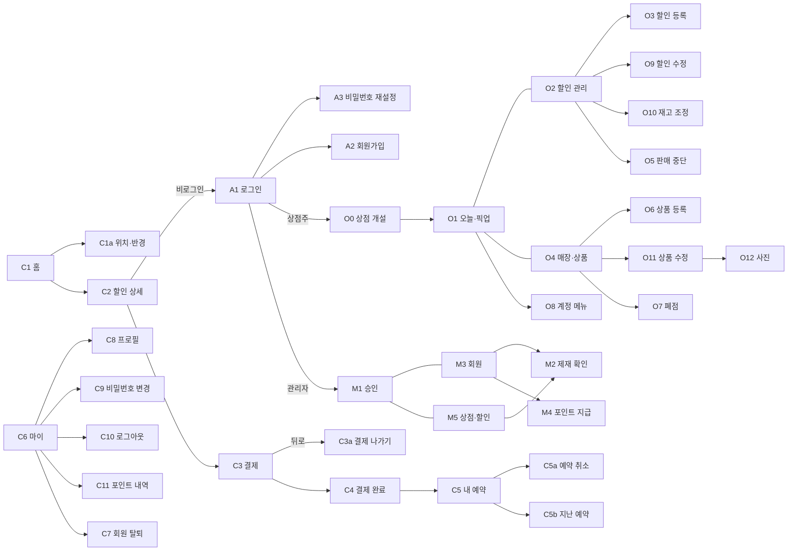

# 레이아웃

## 역할별 셸

| 역할 | 모바일 | PC 브라우저 |
|---|---|---|
| 고객 | 360px 기준, 하단 탭(홈·내 예약·마이) | 모바일 화면 그대로 가운데 420px, 좌우 1px `line`, 바깥은 `bg` |
| 상점주 | 하단 탭(오늘·할인·매장) + 하단 고정 바 | 창 전체 폭, 탭 대신 상단 nav, 하단 바 대신 우측 패널, 목록은 5열 표 |
| 관리자 | 하단 탭(승인·회원·상점·할인) | 상점주와 같은 넓은 배치. PC 우선, 상태 코드 함께 표시 |

## 반응형 기준

기준은 화면 폭이 아니라 **앱 컨테이너 폭 720px**(`container: app / inline-size`, `@container app (min-width:720px)`). 720px 이상이 되면:

- `.tabs` 숨김 → `.bar` 안의 `.nav` 표시
- `.cta`(하단 고정 바) 숨김 → 같은 버튼을 `.dk`(넓은 화면 전용)로 본문·우측 패널에 표시
- `.split` 300px | 1fr, `.split.r` 1fr | 340px(목록 + 우측 상세/입력 패널), `.split.h` 1fr | 1fr(폼 두 열)
- `.tr` 5열 표(1.4fr 1fr 1fr 1fr auto), `.hide` 칸 표시, `.mob` 접힘 줄 숨김
- `.body` 여백 16 → 24px

## 화면 골격

위에서 아래로: **AppBar → 본문(.body, 스크롤) → CtaBar(고정) → TabBar(고정)**. 오버레이는 본문 자리에 `.dim` + `.sheet`.

- 하위 화면(← 있는 화면)에는 TabBar가 없습니다.
- 주 버튼은 하나. 모바일은 CtaBar 안, PC는 패널 안.
- 앱 높이는 화면 높이에 맞추고 본문만 스크롤.

## 화면 연결 지도

- 로그인 후 이동: 고객은 원래 보던 화면(없으면 C1), 상점주는 `GET /v1/stores/me` 결과로 O0 또는 O1, 관리자는 M1.
- 비로그인 고객이 내 예약·마이 탭을 누르면 A1 → 로그인 후 누른 탭.
- O8 계정 메뉴는 상점주·관리자 모든 화면 오른쪽 위 "계정" 버튼에서 열림(C8·C9·C10 공용).
